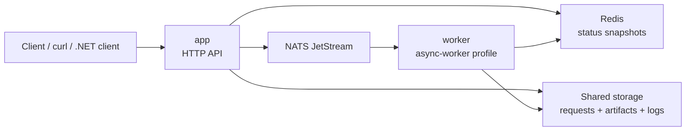

# FOP Converter

FOP Converter is a Java 21 / Spring Boot 3 service for converting documents with Apache FOP. The project supports:

- a synchronous flow: `request -> binary response`
- an asynchronous flow: `submit -> queue -> worker -> status -> download`

The repository includes the backend service, a full local runtime stack for queues and observability, and a .NET 8 sample client.

## Project layout

| Path | Purpose |
| --- | --- |
| `converter-service` | Main backend service |
| `FopClientExample` | Console .NET 8 client |
| `openapi/fop-converter-openapi.yaml` | Public API contract |
| `docker-compose.yml` | Local runtime stack |
| `observability` | Metrics, logs, tracing, and dashboards |
| `smoke-test.ps1` | End-to-end smoke test for sync, async, and observability |
| `font-smoke-test.ps1` | Smoke test for multilingual and font-heavy samples |

## Documentation

- Architecture, endpoint flows, and UML: [docs/architecture.md](docs/architecture.md)
- Public API contract: [openapi/fop-converter-openapi.yaml](openapi/fop-converter-openapi.yaml)
- .NET client documentation: [FopClientExample/README.md](FopClientExample/README.md)
- Local fonts setup: [fonts/README.md](fonts/README.md)

## High-level flow



## API at a glance

| Method | Endpoint | Purpose |
| --- | --- | --- |
| `POST` | `/api/v1/convert/sync` | Synchronous conversion |
| `POST` | `/api/v1/convert` | Async submit |
| `GET` | `/api/v1/jobs/{jobId}` | Async job status |
| `GET` | `/api/v1/jobs/{jobId}/download` | Download artifact |

Supported payload types:

- `XSL_FO`
- `XML_XSLT`

Supported output formats:

- `PDF`
- `POSTSCRIPT`
- `PCL`
- `AFP`
- `IOCA`
- `RTF`
- `XML`
- `TXT`

Detailed sequence diagrams for the endpoints live in [docs/architecture.md](docs/architecture.md).

## Quick start

### Local startup

```powershell
docker compose up -d --build
```

This starts the conversion service, async worker, Redis, and NATS by default.

### Observability stack

```powershell
docker compose -f docker-compose.observability.yml up -d --build
```

### Useful URLs

- Swagger UI: `http://localhost:8080/swagger-ui/index.html`
- Health: `http://localhost:8080/actuator/health`

For the observability stack, Prometheus, Grafana, Kibana, and Elasticsearch are also exposed.

### Rebuild backend

```powershell
docker compose up -d --build app worker
```

## Timeout handling

The service does handle synchronous timeouts. The property is configured in [converter-service/src/main/resources/application.yml](converter-service/src/main/resources/application.yml):

```yaml
converter:
  sync-timeout: ${CONVERTER_SYNC_TIMEOUT:60s}
```

At runtime the controller uses this value in `ConvertController.executeSync()` and schedules a timeout with `CompletableFuture.delayedExecutor(...)`. When the deadline is reached it calls `runningTask.cancel(true)` and completes the future exceptionally with `ConversionException("SYNC_TIMEOUT", "Synchronous conversion timed out")`.

This means slow synchronous conversions are interrupted and the caller receives a timeout error instead of hanging indefinitely.

## Project validation

### Java tests

```powershell
mvn test
```

### .NET client build / validation

```powershell
dotnet build FopClientExample/FopClientExample.sln
dotnet run --project FopClientExample/src/FopClientExample/FopClientExample.csproj
```

### Runtime smoke tests

```powershell
.\smoke-test.ps1
.\font-smoke-test.ps1
```

## Example requests

### Sync: XSL-FO -> PDF

```powershell
curl.exe -X POST http://localhost:8080/api/v1/convert/sync `
  -F payloadType=XSL_FO `
  -F outputFormat=PDF `
  -F primaryDocument=@FopClientExample/samples/sample.fo `
  --output output.pdf
```

### Async: XML + XSLT -> PDF

```powershell
$xml = [Convert]::ToBase64String([IO.File]::ReadAllBytes("FopClientExample/samples/sample.xml"))
$xslt = [Convert]::ToBase64String([IO.File]::ReadAllBytes("FopClientExample/samples/sample.xslt"))
$body = @{
  payloadType = "XML_XSLT"
  outputFormat = "PDF"
  primaryDocumentBase64 = $xml
  primaryFileName = "sample.xml"
  secondaryDocumentBase64 = $xslt
  secondaryFileName = "sample.xslt"
} | ConvertTo-Json

curl.exe -X POST http://localhost:8080/api/v1/convert -H "Content-Type: application/json" -d $body
```

## Troubleshooting

### Async job remains in `pending`

- Check the worker logs: `docker compose logs worker --tail 200`
- Check NATS and Redis: `docker compose ps`
- If the backend was rebuilt recently, retry after the startup warm-up completes

### Elasticsearch or Kibana issues during smoke tests

- Check `http://localhost:9200/_cluster/health`
- Ensure Kibana and the observability bootstrap completed
- Re-running [smoke-test.ps1](smoke-test.ps1) already accounts for transient startup errors in observability HTTP calls

### Glyph and font warnings

- Use the Docker compose stack for stable results
- For local runs outside Docker, prepare fonts using [fonts/README.md](fonts/README.md)
- Sample files are in [FopClientExample/samples](FopClientExample/samples)

### .NET client and status/download URLs

- The client uses `statusUrl` and `downloadUrl` when returned by the server
- If those URLs are absent, it falls back to `GET /api/v1/jobs/{jobId}` and `GET /api/v1/jobs/{jobId}/download`

## Next steps

For a full architecture review, endpoint call flows, and Mermaid UML diagrams, see [docs/architecture.md](docs/architecture.md).

## Additional info

## Short answer

Assuming “NAT” means the project’s **NATS JetStream** queue: yes, it can be disabled with `CONVERTER_NATS_ENABLED=false` (or `converter.nats.enabled=false`). This is a startup configuration change, not a runtime switch. It disables the NATS connection, publisher, and worker consumer. The synchronous endpoint continues to work, but the asynchronous endpoint does not convert directly: it saves the job/payload, then the disabled queue adapter throws `ASYNC_UNAVAILABLE`, mapped to HTTP 503. Because no worker consumes it, the stored request payload is left behind. See `application.yml`, `DisabledJobQueuePort.java`, `SubmitConversionService.java`, and `GlobalExceptionHandler.java`.

Disabling NATS does **not** disable Redis or the filesystem. The synchronous flow still uses Redis for its conversion cache.

## What happens for each request

- **One document, synchronous:** `POST /api/v1/convert/sync` executes conversion in the app process and returns the document bytes in that HTTP response. It bypasses NATS. The flow checks the Redis cache first; a cache hit skips FOP. On a miss, the FOP engine runs. The sync timeout defaults to 60 seconds. `ConvertController.java`, `ConvertSynchronouslyService.java`
- **One document, asynchronous:** `POST /api/v1/convert` stores a pending status in Redis, writes the input payload to shared storage, publishes job metadata to JetStream, and returns `202 Accepted`. The worker later reads the payload, converts it, saves an artifact and final status; the client polls and downloads the result. It avoids keeping the conversion request open, but adds queue/storage/status/download steps and does not make the conversion itself faster. `architecture.md`, `ProcessQueuedConversionService.java`
- **Batch:** There is no batch API in this project. A batch means sending one request per document. Async submissions become separate jobs and can wait independently in the queue; the included .NET example demonstrates individual sync.