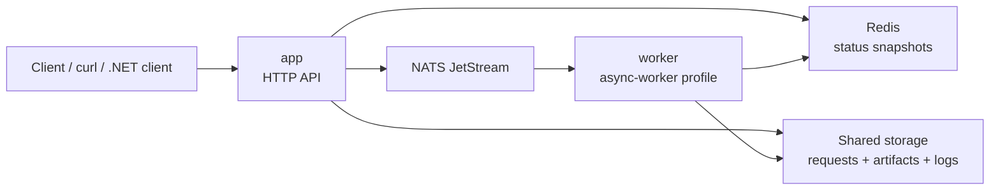

# FOP Converter

FOP Converter — сервис конвертации документов на Java 21 / Spring Boot 3 с Apache FOP, поддерживающий:

- синхронный сценарий `request -> binary response`
- асинхронный сценарий `submit -> queue -> worker -> status -> download`

Репозиторий включает backend, полный локальный runtime stack для очередей и observability, а также пример .NET 8 клиента.

## Что в проекте

| Путь | Назначение |
| --- | --- |
| `converter-service` | Основной backend сервис. |
| `FopClientExample` | Консольный .NET 8 клиент. |
| `openapi/fop-converter-openapi.yaml` | Публичный API-контракт. |
| `docker-compose.yml` | Локальный runtime stack. |
| `observability` | Конфигурация metrics, logs, tracing и dashboards. |
| `smoke-test.ps1` | End-to-end smoke test для sync, async и observability. |
| `font-smoke-test.ps1` | Smoke test для multilingual/font-heavy samples. |

## Документация

- Подробная архитектура, endpoint flows и UML: [docs/architecture.md](docs/architecture.md)
- Публичный контракт API: [openapi/fop-converter-openapi.yaml](openapi/fop-converter-openapi.yaml)
- Документация .NET клиента: [FopClientExample/README.md](FopClientExample/README.md)
- Локальные шрифты и fonts setup: [fonts/README.md](fonts/README.md)

## Краткая схема



## API кратко

| Method | Endpoint | Назначение |
| --- | --- | --- |
| `POST` | `/api/v1/convert/sync` | Синхронная конвертация |
| `POST` | `/api/v1/convert` | Асинхронный submit |
| `GET` | `/api/v1/jobs/{jobId}` | Статус async job |
| `GET` | `/api/v1/jobs/{jobId}/download` | Скачивание готового artifact |

Поддерживаемые payload types:

- `XSL_FO`
- `XML_XSLT`

Поддерживаемые output formats:

- `PDF`
- `POSTSCRIPT`
- `PCL`
- `AFP`
- `IOCA`
- `RTF`
- `XML`
- `TXT`

Подробные sequence diagrams для endpoint-ов вынесены в [docs/architecture.md](docs/architecture.md).

## Быстрый старт

### Полный локальный стек

```powershell
mvn -q -pl converter-service -am package -DskipTests
docker compose up -d --build
```

### Полезные URL

- Swagger UI: `http://localhost:8080/swagger-ui/index.html`
- Health: `http://localhost:8080/actuator/health`
- Prometheus: `http://localhost:9090`
- Grafana: `http://localhost:3000`
- Kibana: `http://localhost:5601`
- Elasticsearch: `http://localhost:9200`

### Пересборка backend

```powershell
docker compose up -d --build app worker
```

## Проверка проекта

### Java tests

```powershell
mvn test
```

### .NET client build / validation

```powershell
dotnet build FopClientExample/FopClientExample.sln
dotnet run --project FopClientExample/src/FopClientExample/FopClientExample.csproj
```

### Runtime smoke tests

```powershell
.\smoke-test.ps1
.\font-smoke-test.ps1
```

## Примеры вызовов

### Sync: XSL-FO -> PDF

```powershell
curl.exe -X POST http://localhost:8080/api/v1/convert/sync `
  -F payloadType=XSL_FO `
  -F outputFormat=PDF `
  -F primaryDocument=@FopClientExample/samples/sample.fo `
  --output output.pdf
```

### Async: XML + XSLT -> PDF

```powershell
$xml = [Convert]::ToBase64String([IO.File]::ReadAllBytes("FopClientExample/samples/sample.xml"))
$xslt = [Convert]::ToBase64String([IO.File]::ReadAllBytes("FopClientExample/samples/sample.xslt"))
$body = @{
  payloadType = "XML_XSLT"
  outputFormat = "PDF"
  primaryDocumentBase64 = $xml
  primaryFileName = "sample.xml"
  secondaryDocumentBase64 = $xslt
  secondaryFileName = "sample.xslt"
} | ConvertTo-Json

curl.exe -X POST http://localhost:8080/api/v1/convert -H "Content-Type: application/json" -d $body
```

## Troubleshooting

### Async job остаётся в `pending`

- Проверьте `worker`: `docker compose logs worker --tail 200`
- Проверьте `nats` и `redis`: `docker compose ps`
- Если backend только что пересобран, повторите запрос после завершения startup warm-up

### Проблемы с Elasticsearch или Kibana в smoke test

- Сначала проверьте `http://localhost:9200/_cluster/health`
- Убедитесь, что `kibana` и `observability-bootstrap` успели завершить bootstrap
- Повторный запуск [smoke-test.ps1](smoke-test.ps1) уже учитывает transient warm-up ошибки observability HTTP calls

### Предупреждения по glyphs или fonts

- Для стабильного результата используйте Docker compose stack
- Для локального запуска вне Docker подготовьте шрифты по [fonts/README.md](fonts/README.md)
- Samples для проверки лежат в [FopClientExample/samples](FopClientExample/samples)

### .NET client и URL статуса/скачивания

- Клиент использует `statusUrl` и `downloadUrl`, если сервер их возвращает
- При отсутствии этих URL он fallback-ится к `GET /api/v1/jobs/{jobId}` и `GET /api/v1/jobs/{jobId}/download`

## Что дальше читать

Если нужен полный разбор архитектуры, паттернов, endpoint call flows и Mermaid UML-диаграмм, переходите в [docs/architecture.md](docs/architecture.md).
