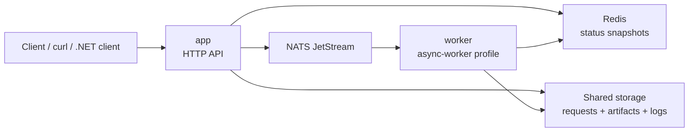

# FOP Converter

FOP Converter — это сервис на Java 21 / Spring Boot 3 для конвертации документов с помощью Apache FOP. Проект поддерживает:

- синхронный сценарий: `request -> binary response`
- асинхронный сценарий: `submit -> queue -> worker -> status -> download`

Репозиторий включает backend-сервис, полный локальный runtime stack для очередей и observability, а также пример клиента на .NET 8.

## Структура проекта

| Путь | Назначение |
| --- | --- |
| `converter-service` | Основной backend-сервис |
| `FopClientExample` | Консольный клиент на .NET 8 |
| `openapi/fop-converter-openapi.yaml` | Публичный API-контракт |
| `docker-compose.yml` | Локальный runtime stack |
| `observability` | Метрики, логи, tracing и dashboards |
| `smoke-test.ps1` | End-to-end smoke test для sync, async и observability |
| `font-smoke-test.ps1` | Smoke test для multilingual/font-heavy samples |

## Документация

- Архитектура, flows endpoint-ов и UML: [docs/architecture.md](docs/architecture.md)
- Публичный контракт API: [openapi/fop-converter-openapi.yaml](openapi/fop-converter-openapi.yaml)
- Документация .NET клиента: [FopClientExample/README.md](FopClientExample/README.md)
- Настройка локальных шрифтов: [fonts/README.md](fonts/README.md)

## Общая схема



## API в 2 словах

| Method | Endpoint | Назначение |
| --- | --- | --- |
| `POST` | `/api/v1/convert/sync` | Синхронная конвертация |
| `POST` | `/api/v1/convert` | Асинхронный submit |
| `GET` | `/api/v1/jobs/{jobId}` | Статус async job |
| `GET` | `/api/v1/jobs/{jobId}/download` | Скачивание готового artifact |

Поддерживаемые payload types:

- `XSL_FO`
- `XML_XSLT`

Поддерживаемые output formats:

- `PDF`
- `POSTSCRIPT`
- `PCL`
- `AFP`
- `IOCA`
- `RTF`
- `XML`
- `TXT`

Подробные sequence diagrams для endpoint-ов находятся в [docs/architecture.md](docs/architecture.md).

## Быстрый старт

### Локальный запуск

```powershell
docker compose up -d --build
```

По умолчанию запускаются сервис конвертации, async worker, Redis и NATS.

### Стек с observability

```powershell
docker compose -f docker-compose.observability.yml up -d --build
```

### Полезные URL

- Swagger UI: `http://localhost:8080/swagger-ui/index.html`
- Health: `http://localhost:8080/actuator/health`

Для observability stack дополнительно доступны Prometheus, Grafana, Kibana и Elasticsearch.

### Пересборка backend

```powershell
docker compose up -d --build app worker
```

## Обработка таймаутов

Сервис действительно обрабатывает таймауты синхронных запросов. Настройка задаётся в [converter-service/src/main/resources/application.yml](converter-service/src/main/resources/application.yml):

```yaml
converter:
  sync-timeout: ${CONVERTER_SYNC_TIMEOUT:60s}
```

Во время выполнения контроллер использует это значение в `ConvertController.executeSync()` и планирует таймаут через `CompletableFuture.delayedExecutor(...)`. Когда срок истекает, он вызывает `runningTask.cancel(true)` и завершает future с исключением `ConversionException("SYNC_TIMEOUT", "Synchronous conversion timed out")`.

То есть долгие синхронные конверсии прерываются и клиент получает ошибку таймаута вместо бесконечного ожидания.

## Проверка проекта

### Java tests

```powershell
mvn test
```

### .NET client build / validation

```powershell
dotnet build FopClientExample/FopClientExample.sln
dotnet run --project FopClientExample/src/FopClientExample/FopClientExample.csproj
```

### Runtime smoke tests

```powershell
.\smoke-test.ps1
.\font-smoke-test.ps1
```

## Примеры вызовов

### Sync: XSL-FO -> PDF

```powershell
curl.exe -X POST http://localhost:8080/api/v1/convert/sync `
  -F payloadType=XSL_FO `
  -F outputFormat=PDF `
  -F primaryDocument=@FopClientExample/samples/sample.fo `
  --output output.pdf
```

### Async: XML + XSLT -> PDF

```powershell
$xml = [Convert]::ToBase64String([IO.File]::ReadAllBytes("FopClientExample/samples/sample.xml"))
$xslt = [Convert]::ToBase64String([IO.File]::ReadAllBytes("FopClientExample/samples/sample.xslt"))
$body = @{
  payloadType = "XML_XSLT"
  outputFormat = "PDF"
  primaryDocumentBase64 = $xml
  primaryFileName = "sample.xml"
  secondaryDocumentBase64 = $xslt
  secondaryFileName = "sample.xslt"
} | ConvertTo-Json

curl.exe -X POST http://localhost:8080/api/v1/convert -H "Content-Type: application/json" -d $body
```

## Troubleshooting

### Async job остаётся в `pending`

- Проверьте `worker`: `docker compose logs worker --tail 200`
- Проверьте `nats` и `redis`: `docker compose ps`
- Если backend только что пересобран, повторите запрос после завершения startup warm-up

### Проблемы с Elasticsearch или Kibana в smoke test

- Сначала проверьте `http://localhost:9200/_cluster/health`
- Убедитесь, что `kibana` и `observability-bootstrap` успели завершить bootstrap
- Повторный запуск [smoke-test.ps1](smoke-test.ps1) уже учитывает transient warm-up ошибки observability HTTP calls

### Предупреждения по glyphs или fonts

- Для стабильного результата используйте Docker compose stack
- Для локального запуска вне Docker подготовьте шрифты по [fonts/README.md](fonts/README.md)
- Samples для проверки лежат в [FopClientExample/samples](FopClientExample/samples)

### .NET client и URL статуса/скачивания

- Клиент использует `statusUrl` и `downloadUrl`, если сервер их возвращает
- При отсутствии этих URL он fallback-ится к `GET /api/v1/jobs/{jobId}` и `GET /api/v1/jobs/{jobId}/download`

## Что дальше читать

Если нужен полный разбор архитектуры, паттернов, endpoint call flows и Mermaid UML-диаграмм, переходите в [docs/architecture.md](docs/architecture.md).

## Дополнительная информация

Предполагая, что “NAT” означает очередь проекта NATS JetStream: да, ее можно отключить с помощью `CONVERTER_NATS_ENABLED=false` (или `converter.nats.enabled=false`). Это изменение конфигурации при запуске, а не переключение во время выполнения. Оно отключает подключение NATS, издателя и рабочего пользователя. Синхронная конечная точка продолжает работать, но асинхронная конечная точка не преобразуется напрямую: она сохраняет задание/полезную нагрузку, затем отключенный адаптер очереди выдает "ASYNC_UNAVAILABLE", сопоставленный с HTTP 503. Поскольку ни один рабочий не использует его, сохраненная полезная нагрузка запроса остается. Смотрите "application.yml", "DisabledJobQueuePort.java`, "SubmitConversionService.java` и `GlobalExceptionHandler.java`.

Отключение NATS не приводит к отключению Redis или файловой системы. Синхронный поток по-прежнему использует Redis в качестве кэша преобразования.

## Что происходит для каждого запроса

- **Один документ, синхронный:** `POST /api/v1/convert/sync` выполняет преобразование в процессе приложения и возвращает байты документа в этом HTTP-ответе. Это обходит NATS. Сначала поток проверяет кэш Redis; попадание в кэш пропускает FOP. При промахе запускается двигатель FOP. Время ожидания синхронизации по умолчанию равно 60 секундам. `ConvertController.java`, `ConvertSynchronouslyService.java`
- **Один документ, асинхронный:** `POST /api/v1/convert` сохраняет статус ожидания в Redis, записывает входную полезную нагрузку в общее хранилище, публикует метаданные задания в JetStream и возвращает "202 Принято`. Позже рабочий считывает полезную нагрузку, преобразует ее, сохраняет артефакт и окончательный статус; клиент опрашивает и загружает результат. Это позволяет избежать сохранения запроса на конвертацию открытым, но добавляет этапы очереди / хранения / статуса / загрузки и не ускоряет само преобразование. `architecture.md`,  `ProcessQueuedConversionService.java`
- **Пакетная обработка:** В этом проекте нет пакетного API. Пакетная обработка означает отправку одного запроса на каждый документ. Асинхронные отправки становятся отдельными заданиями и могут независимо ожидать в очереди.Пример NET демонстрирует индивидуальную синхронизацию.