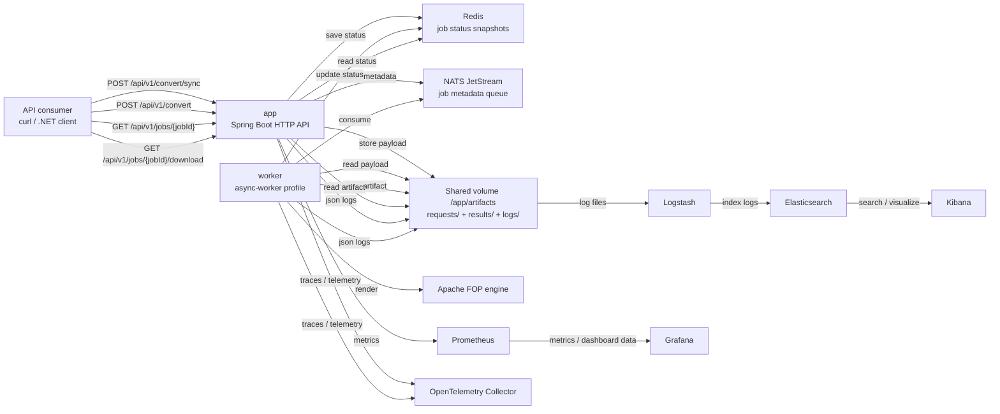
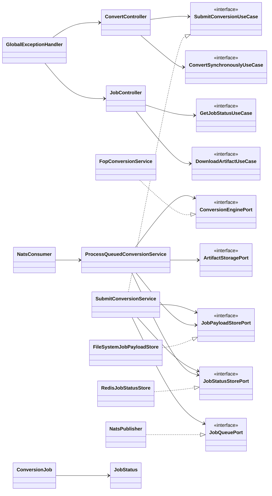
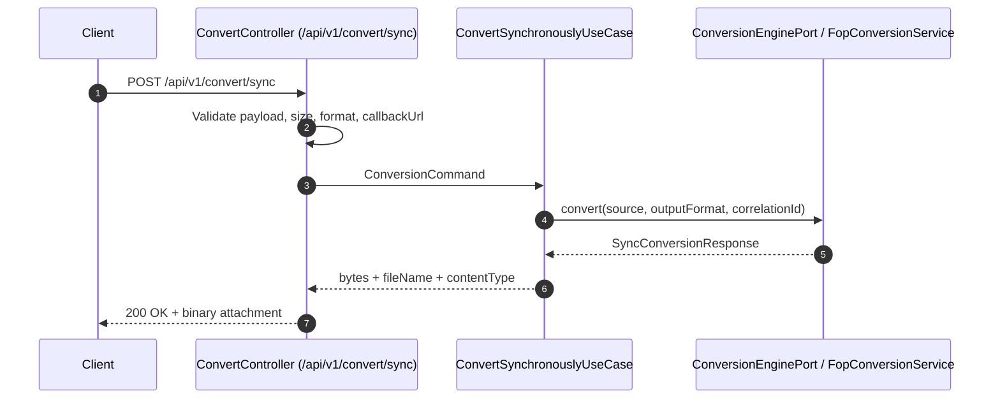
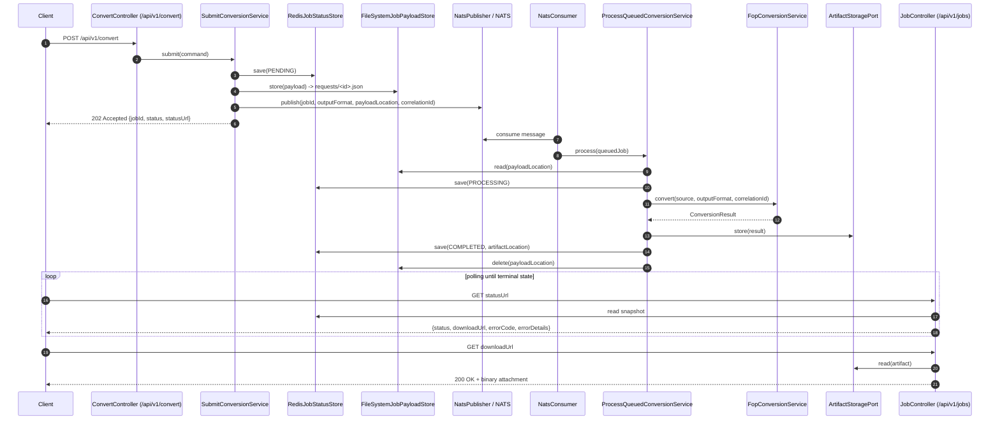
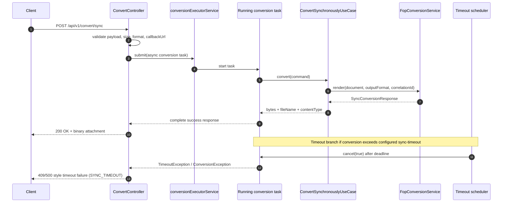
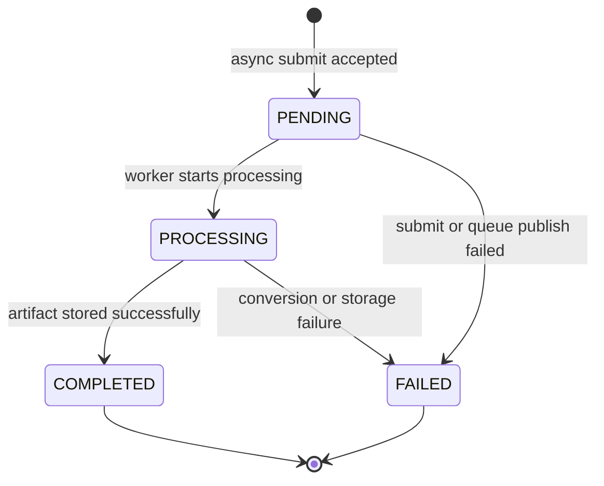

# FOP Converter Architecture

This document describes the internal architecture of the project, the roles of the components, the endpoint flows, and the architectural approaches used.

## 1. System overview

FOP Converter is a document conversion service that supports two different modes:

- sync conversion for a short HTTP request/response flow
- async conversion for heavy jobs that must be processed by a worker outside the request lifecycle

The system separates:

- HTTP API and async worker
- message queue and payload storage
- status snapshots and binary artifacts
- domain model and infrastructure adapters

## 2. System diagram



## 3. Backend structure by layer

The actual backend code is organized into package layers:

- `domain`
- `application`
- `interfaceadapter`
- `infrastructure`

### Layer responsibilities

| Layer | Purpose |
| --- | --- |
| `domain` | Invariants, statuses, value objects, and the domain model without Spring or infrastructure dependencies |
| `application` | Use cases, DTOs, orchestration, application services, and ports |
| `interfaceadapter` | Web adapters, controllers, and exception mapping |
| `infrastructure` | Redis, NATS, filesystem, Apache FOP, and Spring configuration |

### UML: key backend components



## 4. API surface

The main contract is defined in [openapi/fop-converter-openapi.yaml](../openapi/fop-converter-openapi.yaml).

### Supported payload types

| Payload type | Description |
| --- | --- |
| `XSL_FO` | A single XSL-FO document |
| `XML_XSLT` | XML + XSLT documents |

### Supported output formats

- `PDF`
- `POSTSCRIPT`
- `PCL`
- `AFP`
- `IOCA`
- `RTF`
- `XML`
- `TXT`

### Endpoint table

| Method | Endpoint | Purpose | Controller |
| --- | --- | --- | --- |
| `POST` | `/api/v1/convert/sync` | sync conversion | `ConvertController` |
| `POST` | `/api/v1/convert` | async submit | `ConvertController` |
| `GET` | `/api/v1/jobs/{jobId}` | status lookup | `JobController` |
| `GET` | `/api/v1/jobs/{jobId}/download` | artifact download | `JobController` |

### Routing map

```mermaid
flowchart TB
    Client["Client / curl / .NET client"]

    Client -->|POST /api/v1/convert/sync| SyncRoute["ConvertController\nconvertSyncJson / convertSyncMultipart"]
    Client -->|POST /api/v1/convert| AsyncRoute["ConvertController\nsubmitJson / submitMultipart"]
    Client -->|GET /api/v1/jobs/{jobId}| StatusRoute["JobController\nstatus"]
    Client -->|GET /api/v1/jobs/{jobId}/download| DownloadRoute["JobController\ndownload"]
```

## 5. Endpoint call flows

### 5.1 Sync flow



### 5.2 Async flow



### 5.3 Code execution flow (sync timeout path)



## 6. State model

Async jobs move through an explicit lifecycle.



Statuses are based on the domain enum `JobStatus`:

- `PENDING`
- `PROCESSING`
- `COMPLETED`
- `FAILED`

## 7. Architectural patterns and decisions

### 7.1 Clean Architecture / Ports and Adapters

- Controllers do not call infrastructure directly.
- The application layer depends on ports rather than concrete Redis, NATS, filesystem, or FOP implementations.
- Infrastructure implements the ports rather than orchestrating the flow.

### 7.2 Message-driven async processing

- Async submission is separated from worker execution.
- The HTTP request completes before the actual conversion pipeline.
- The queue stores metadata only, not the large payload itself.

### 7.3 File-backed payload handoff

- Payloads are stored in a shared filesystem.
- A `payloadLocation` is passed through JetStream.
- The worker reads the payload by reference and deletes it after terminal processing.

This reduces queue message size and makes the queue more resilient for large documents.

### 7.4 Explicit state machine and status snapshots

- Redis stores the status snapshot.
- Binary artifacts are stored separately.
- The API reads status separately from the actual file.

### 7.5 Resilience

- Document size limits are enforced at the boundary.
- `callbackUrl` is explicitly rejected because the delivery pipeline is not implemented.
- The sync path is protected by a timeout and best-effort cancellation.
- The async pipeline distinguishes poison messages from transient failures.

### 7.6 Observability by design

- JSON logs are produced by both `app` and `worker`.
- Logstash indexes logs into Elasticsearch.
- Prometheus and Grafana are used for metrics.
- The OpenTelemetry Collector receives traces and telemetry.

## 8. Runtime topology through Docker Compose

| Service | Role |
| --- | --- |
| `app` | HTTP API, sync conversion, async submit, and status/download endpoints |
| `worker` | Headless async worker |
| `redis` | Status snapshots |
| `nats` | JetStream queue |
| `elasticsearch` | Log storage and search |
| `kibana` | Log analysis UI |
| `logstash` | Log shipping |
| `prometheus` | Metrics scraping |
| `grafana` | Metrics dashboards |
| `otel-collector` | Telemetry ingestion |
| `observability-bootstrap` | Kibana/Data View bootstrap |

### Runtime-specific notes

- `app` and `worker` use the same image but different Spring profiles.
- `worker` starts with the `async-worker` profile and does not expose an HTTP server.
- The shared volume `app-artifacts` is used for payloads, artifacts, and logs.
- The NATS stream is created before the consumer subscription is started so the worker can safely start even in a fresh environment.

## 9. .NET client integration

[FopClientExample](../FopClientExample) shows the external consumer-side usage of the API.

Client features:

- `IHttpClientFactory`
- retry on transient HTTP errors
- polling for async status
- using `statusUrl` and `downloadUrl` from API responses
- fallback to legacy `jobId` routes if URLs are not provided

## 10. Things to keep in mind during project evolution

- Do not move binary payloads back into the queue message.
- Do not mix HTTP concerns with async worker orchestration.
- Do not store binary artifacts in the status store.
- Do not add a "mostly supported" public contract if the actual delivery semantics are not implemented.
- When changing API routes or response URLs, update the OpenAPI spec, the .NET client, and the smoke tests.
