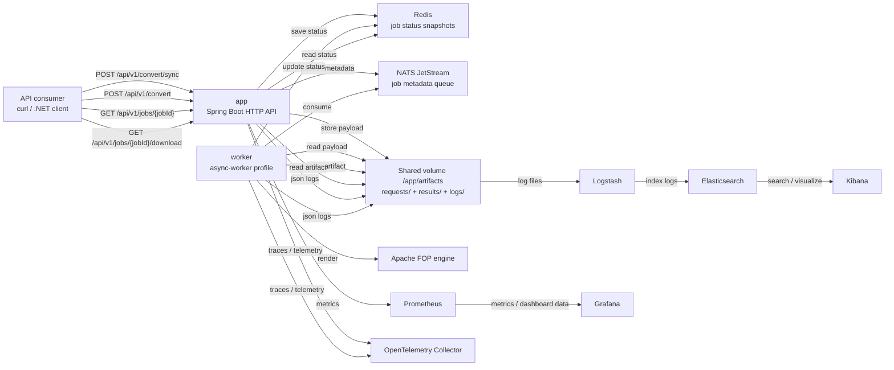
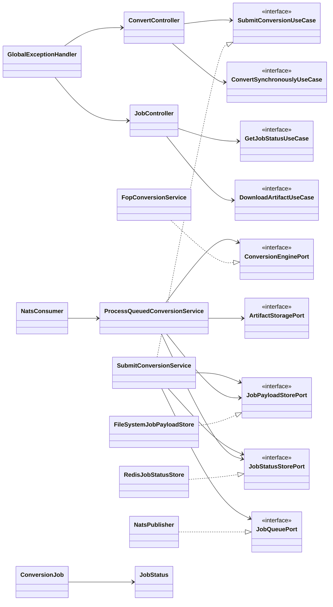
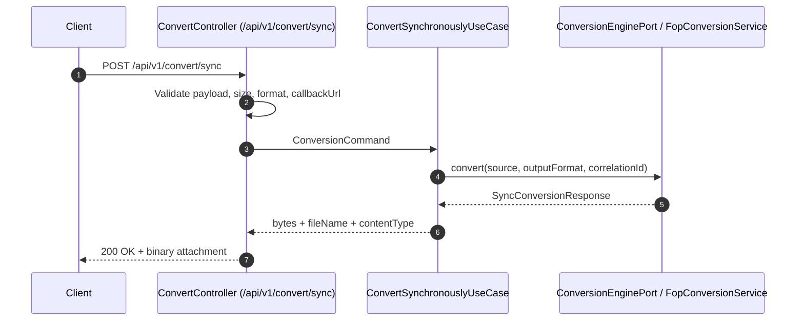
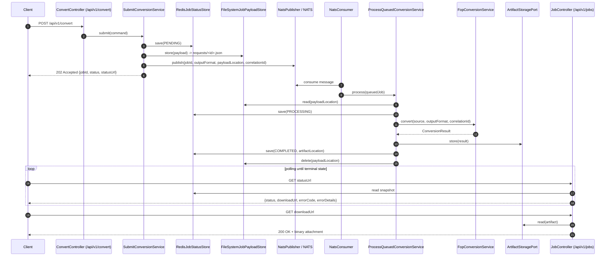
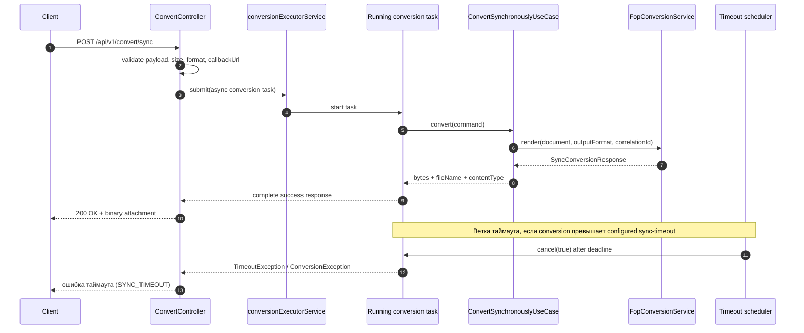
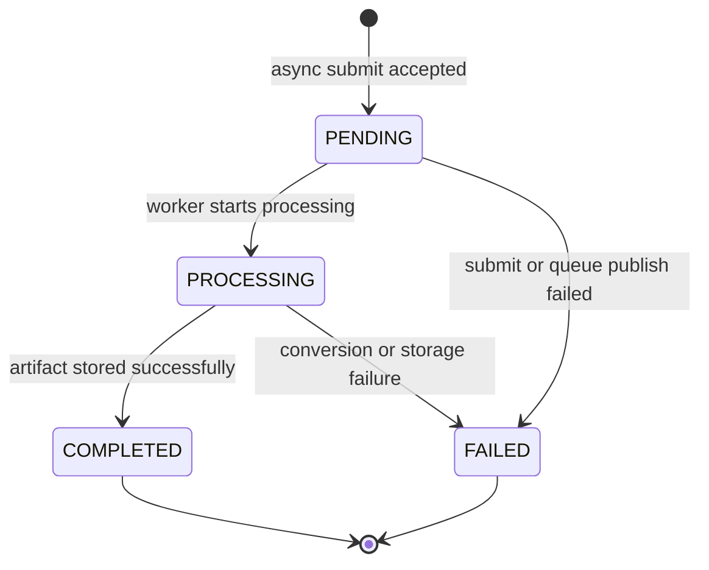

# FOP Converter Architecture

Этот документ описывает внутреннюю архитектуру проекта, роли компонентов, flows endpoint-ов и используемые архитектурные подходы.

## 1. Обзор системы

FOP Converter — это сервис конвертации документов, который поддерживает два разных режима:

- sync conversion для короткого HTTP request/response сценария
- async conversion для тяжёлых задач, которые должны обрабатываться worker-процессом вне request lifecycle

Система разделяет:

- HTTP API и async worker
- очередь сообщений и хранение payload
- status snapshots и binary artifacts
- доменную модель и infrastructure adapters

## 2. Системная диаграмма



## 3. Структура backend по слоям

Фактическая структура backend-кода организована по package-слоям:

- `domain`
- `application`
- `interfaceadapter`
- `infrastructure`

### Назначение слоёв

| Слой | Назначение |
| --- | --- |
| `domain` | Инварианты, статусы, value objects, domain model без Spring и без инфраструктурных зависимостей |
| `application` | Use cases, DTO, orchestration, application services, порты |
| `interfaceadapter` | Web adapters, controllers, exception mapping |
| `infrastructure` | Redis, NATS, filesystem, Apache FOP, Spring configuration |

### UML: ключевые backend-компоненты



## 4. API surface

Основной контракт определён в [openapi/fop-converter-openapi.yaml](../openapi/fop-converter-openapi.yaml).

### Поддерживаемые payload types

| Payload type | Описание |
| --- | --- |
| `XSL_FO` | Один XSL-FO документ |
| `XML_XSLT` | XML + XSLT документы |

### Поддерживаемые output formats

- `PDF`
- `POSTSCRIPT`
- `PCL`
- `AFP`
- `IOCA`
- `RTF`
- `XML`
- `TXT`

### Таблица endpoint-ов

| Method | Endpoint | Назначение | Controller |
| --- | --- | --- | --- |
| `POST` | `/api/v1/convert/sync` | sync conversion | `ConvertController` |
| `POST` | `/api/v1/convert` | async submit | `ConvertController` |
| `GET` | `/api/v1/jobs/{jobId}` | status lookup | `JobController` |
| `GET` | `/api/v1/jobs/{jobId}/download` | artifact download | `JobController` |

### Routing map

```mermaid
flowchart TB
    Client["Client / curl / .NET client"]

    Client -->|POST /api/v1/convert/sync| SyncRoute["ConvertController\nconvertSyncJson / convertSyncMultipart"]
    Client -->|POST /api/v1/convert| AsyncRoute["ConvertController\nsubmitJson / submitMultipart"]
    Client -->|GET /api/v1/jobs/{jobId}| StatusRoute["JobController\nstatus"]
    Client -->|GET /api/v1/jobs/{jobId}/download| DownloadRoute["JobController\ndownload"]
```

## 5. Endpoint call flows

### 5.1 Sync flow



### 5.2 Async flow



### 5.3 Поток выполнения кода (сценарий таймаута синхронного вызова)



## 6. State model

Async job проходит явный lifecycle.



Статусы основаны на domain enum `JobStatus`:

- `PENDING`
- `PROCESSING`
- `COMPLETED`
- `FAILED`

## 7. Архитектурные шаблоны и решения

### 7.1 Clean Architecture / Ports and Adapters

- Controllers не вызывают infrastructure напрямую.
- Application layer зависит от портов, а не от конкретных реализаций Redis, NATS, filesystem или FOP.
- Infrastructure реализует порты, а не определяет orchestration.

### 7.2 Message-driven async processing

- Async submit отделён от worker execution.
- HTTP request завершается раньше, чем фактический conversion pipeline.
- Очередь не хранит большой payload, только metadata.

### 7.3 File-backed payload handoff

- Payload сохраняется в shared filesystem.
- В JetStream передаётся `payloadLocation`.
- Worker читает payload по ссылке и удаляет его после terminal processing.

Это снижает размер сообщения и делает очередь более устойчивой к большим документам.

### 7.4 Explicit state machine и status snapshots

- Redis хранит status snapshot.
- Binary artifact хранится отдельно.
- API читает status отдельно от фактического файла.

### 7.5 Resilience

- Ограничение размера документов проверяется на boundary.
- `callbackUrl` явно отвергается, потому что delivery pipeline не реализован.
- Sync path защищён timeout и best-effort cancellation.
- Async pipeline различает poison message и transient failure.

### 7.6 Observability by design

- JSON logs создаются и в `app`, и в `worker`.
- Logstash индексирует logs в Elasticsearch.
- Prometheus/Grafana используются для metrics.
- OpenTelemetry Collector принимает traces/telemetry.

## 8. Runtime topology через Docker Compose

| Service | Роль |
| --- | --- |
| `app` | HTTP API, sync conversion, async submit, status/download endpoints |
| `worker` | Headless async worker |
| `redis` | Status snapshots |
| `nats` | JetStream queue |
| `elasticsearch` | Log storage and search |
| `kibana` | Log analysis UI |
| `logstash` | Log shipping |
| `prometheus` | Metrics scraping |
| `grafana` | Metrics dashboards |
| `otel-collector` | Telemetry ingestion |
| `observability-bootstrap` | Kibana/Data View bootstrap |

### Runtime-specific notes

- `app` и `worker` используют один image, но разные Spring profiles.
- `worker` запускается с `async-worker` и не поднимает HTTP server.
- Shared volume `app-artifacts` используется для payload, artifacts и logs.
- NATS stream создаётся до старта consumer subscription, чтобы worker мог безопасно стартовать даже на чистом окружении.

## 9. .NET client integration

[FopClientExample](../FopClientExample) показывает внешний consumer-side сценарий использования API.

Особенности клиента:

- `IHttpClientFactory`
- retry на transient HTTP errors
- polling async status
- использование `statusUrl` и `downloadUrl` из API responses
- fallback на legacy `jobId` routes, если URL не переданы

## 10. Что важно помнить при развитии проекта

- Не переносить binary payload обратно в queue message.
- Не смешивать HTTP concerns и async worker orchestration.
- Не хранить binary artifact внутри status store.
- Не добавлять "почти поддержанный" public contract, если реальной delivery semantics для него нет.
- При изменении API routes или response URLs обновлять и OpenAPI, и .NET client, и smoke tests.
